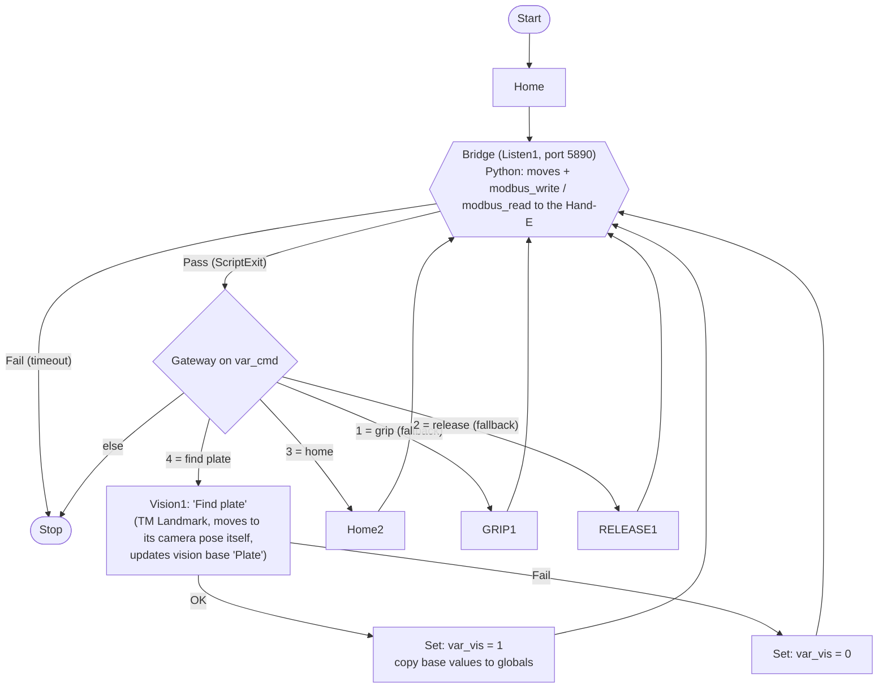
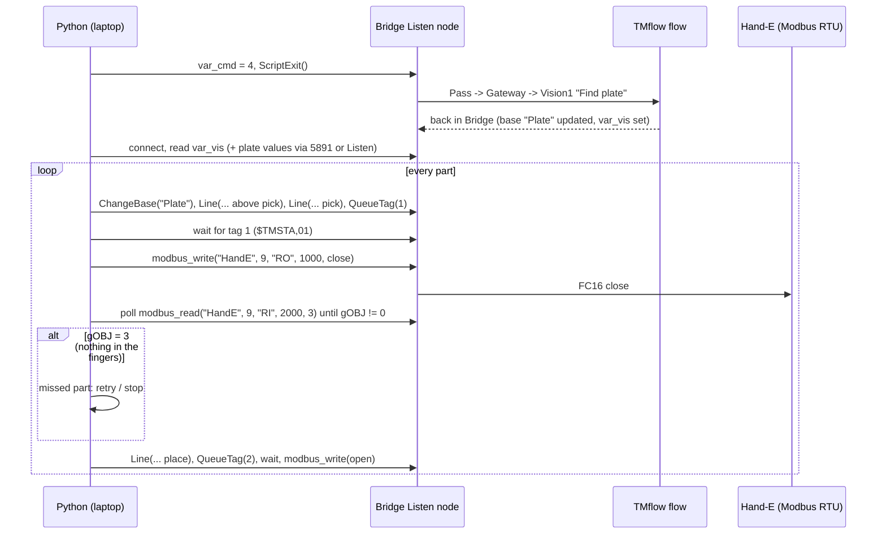
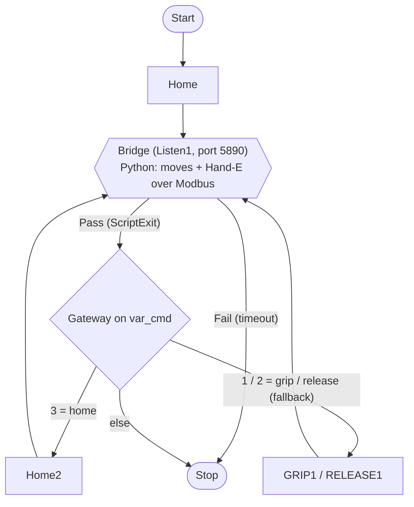
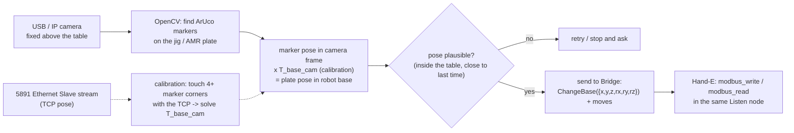

# Plan: camera data and Hand-E gripper without the Listen-node detour (TMflow 1.88)

Today every grip and every vision job means: set `var_cmd`, `ScriptExit()`, the flow runs the TMflow node,
reconnect to the next Listen node (`tests/hande_bridge.py`). TMflow 2's Script Project would call vision from
code (`Vision_DoJob_PTP`), but it needs TMflow 2.22+ / HW5.0 and still can't run the Robotiq component, so it's
out. This plan finds what 1.88 *can* do from the laptop.

Sources read (2026-11-09):
- *Expression Editor and Listen Node*, software 1.68 (Omron/Techman). Our robot is on 1.88, which should have
  at least these functions. Ch. 3 = Modbus, ch. 4 = Listen node.
- *TMflow Version 2 Software Manual* (I689), only to see what TMflow 2 adds.
- Not yet read: Robotiq *Hand-E for TM Series* manual (download failed from here). Register numbers below are
  Robotiq's standard Hand-E map, **check them against §4 of that manual before writing anything**.

## Part A: Hand-E straight over Modbus RTU (highest value, try first)

**Why it should work.** The Hand-E TM kit talks **Modbus RTU over RS485** (RS232→RS485 converter into the
control box). The Robotiq SET/GRIP/RELEASE components just send Modbus. A Listen node can run every
Expression Editor function, and that includes `modbus_read()` / `modbus_write()` on an **RTU device** set up
under TMflow's Modbus Device settings. So the laptop could send gripper commands inside the Listen node, in
the same `$TMSCT` packet as the moves. No ScriptExit, no reconnect, no `HandE_Bridge_v1` flow.

Functions (manual §3.1, §3.7, user-defined forms, big-endian):
```
modbus_write("HandE", 9, "RO", 1000, byte[])   // FC16, write registers from 1000
modbus_read ("HandE", 9, "RI", 2000, 3)        // FC04, read 3 registers from 2000 -> byte[6]
```

Hand-E register map (Robotiq standard, **verify**): RTU 115200 baud 8N1, slave ID 9.

| Register | High byte | Low byte |
|---|---|---|
| 1000 (write) | action: bit0 rACT activate, bit3 rGTO go | reserved |
| 1001 (write) | reserved | rPR target position, 0 = open, 255 = closed |
| 1002 (write) | rSP speed | rFR force |
| 2000 (read) | status: gACT, gGTO, gSTA (bits 4-5, 3 = activated), gOBJ (bits 6-7) | reserved |
| 2001 (read) | fault | position echo |
| 2002 (read) | gPO actual position | current |

`gOBJ`: 0 = moving, 1/2 = stopped on an object, 3 = reached position with no object. That gives us a
**grip check for free**, which could replace the GripLost branch.

Commands to try:
```
byte[] rst  = {0x00,0x00, 0x00,0x00, 0x00,0x00}   // reset
byte[] act  = {0x01,0x00, 0x00,0x00, 0x00,0x00}   // activate, then poll 2000 until gSTA = 3
byte[] shut = {0x09,0x00, 0x00,0xFF, 0xFF,0x80}   // go, closed, full speed, half force
byte[] open = {0x09,0x00, 0x00,0x00, 0xFF,0x80}   // go, open
```

### Steps (at the lab, robot in Manual mode, nothing in the fingers)
1. **Find the RTU device.** In TMflow (Settings → Modbus Device / External Device) see whether the Robotiq
   SET component created an RTU device: name, COM port, baud, slave ID. If not, create one called `HandE`
   with Robotiq's settings. Write down what you find, it's the only thing we're guessing.
2. **Read only.** From a Listen node: `byte[] s = modbus_read("HandE", 9, "RI", 2000, 3)`. Check that the
   values follow the gripper when you open and close it with the TMflow components. This step can't move
   anything.
3. **Write.** Reset, activate, open, close, from the Listen node. Watch for a conflict with the Robotiq
   component if it's still in the flow: take SET out of the test project.
4. **Order relative to moves.** The manual says *"motion command and IO value assigning … will be placed in
   queue"*. It doesn't say whether `modbus_write` is queued or runs at once. Test: send `Line(...)` followed by
   a close in one packet and see whether the gripper closes before the move ends. If it doesn't wait: wait
   for the move with `QueueTag` (we already do, `listen_pick_place_test.py:108`), then send the Modbus write
   as its own packet.
5. **Settle detection.** After `shut`, poll register 2000 until gOBJ ≠ 0: object → carry on, 3 → missed part.
6. **Fold into the code.** A `HandEModbus` class next to `hande_bridge.py` with the same `grip()` / `release()`
   calls, so `robot_cell.py` / the demo scripts can switch with one flag. Add the RTU calls to
   `tests/tmflow_mock.py` so the mock still runs the whole program.

**Fallback.** If RTU from the Listen node doesn't work (device busy, not allowed): keep `hande_bridge.py`.
It works, it's just slower.

## Part B: TM camera data

1.88 has no script call that runs a vision job (that's TMflow 2 only), so **triggering** still needs a Vision
node in the flow. What we can do without extra steps is **getting the result out**:

1. **Vision node as one more `var_cmd` branch** in the bridge flow (`var_cmd = 3` → Vision node "Find
   plate" → back to the Listen node). It's one detour per cycle, not per grip, so it costs very little.
2. **The vision base updates itself.** Moves sent with `ChangeBase("AMR plate")` follow it, so the laptop
   often doesn't need the numbers at all.
3. **If we want the numbers on the laptop** (logging, our own check, the 3D viewer):
   - Copy the vision results into global variables in the flow (a Set node after the Vision node), then read
     them:
     - from the Ethernet Slave stream (port 5891), which we already read in `log_points.py` and
       `demo_viewer.py`, by adding them as user-defined items (check that 1.88 allows variables there); or
     - from the Listen node itself, e.g. by having the robot send them back to us. Check which reply function
       1.88 has, the 1.68 manual only lists `ListenPacket()`.
   - Also check the TMflow Vision Record / Modbus slave table for vision fields.
4. **Open questions**: the vision licence on 1.88, Landmark accuracy with the lab's light (both already in
   `AMR delivery plan.md`).

## Part C: our own camera (only if B fails or the TM camera is locked)

A fixed USB/IP camera on the laptop, independent of TMflow:
1. Mount it above the table. Print ArUco markers on the jig plate / AMR plate.
2. **Calibration**: OpenCV intrinsics (checkerboard), then camera → robot base: touch 4+ marker corners with
   the TCP (positions from 5891), solve the transform. The same method as teaching the jig base.
3. Each cycle: detect the marker → plate pose in the robot base → send the corrected base or targets to the
   Listen node as numbers (`ChangeBase({x,y,z,rx,ry,rz})`).
4. Check the accuracy: a 1080p camera over ~600 mm gives ~0.5 mm/px. Compare against touching the corners;
   it must stay inside what the jig's chamfers can take.

Pros: no TMflow licence, full control, and the image ends up on the laptop (works with the viewer). Cons: a
second calibration to look after, and mounting it.

## Flow drafts

Both drafts start from today's `HandE_Bridge_v1` (`tests/hande_bridge.py`): Python does every move, the
flow waits in one Listen node ("Bridge"), and `var_cmd` picks a branch (1 = GRIP, 2 = RELEASE, 3 = Home).
These are drafts to build at the lab. Node names follow TMflow's own naming (Listen1, Vision1, ...).

### Draft 1: `Bench_Bridge_v2` — TM camera (Vision node) + gripper over Modbus

Gripper commands go **inside** the Bridge node (`modbus_write`), so a grip no longer leaves the node. The
camera is the only reason to leave it: `var_cmd = 4`. GRIP1/RELEASE1 stay as a fallback until Modbus is proven.



Same thing in the docstring style:
```
Start -> Home -> Bridge
Bridge Pass -> Gateway   var_cmd == 4 -> Vision1 "Find plate"  OK -> Set var_vis = 1 (+ globals) -> Bridge
                                                               FAIL -> Set var_vis = 0 -> Bridge
                         var_cmd == 3 -> Home2 -> Bridge
                         var_cmd == 1 -> GRIP1 -> Bridge        (fallback, delete once Modbus works)
                         var_cmd == 2 -> RELEASE1 -> Bridge     (fallback)
                         else         -> Stop
Bridge Fail -> Stop
```

One bench cycle, laptop side:


Things to check in this draft:
- The Robotiq **SET node is gone**: the script activates the gripper over Modbus (reset, activate, wait
  for gSTA = 3). If the fallback GRIP1/RELEASE1 nodes stay in the flow, check that they and our script don't
  fight over the same RTU device.
- **What the vision base is called and how to copy its values into globals** (the Set node after Vision1).
- **The Vision node's own camera pose**: it moves the robot by itself. Make sure that pose is clear of the jig
  from wherever the script left the robot (send it Home first if not).

### Draft 2: `Bench_Bridge_v3` — our own camera on the laptop + gripper over Modbus

The camera never touches TMflow. The flow shrinks to a Home and one Listen node. Everything else happens in
Python.



```
Start -> Home -> Bridge
Bridge Pass -> Gateway   var_cmd == 3 -> Home2 -> Bridge
                         var_cmd == 1 / 2 -> GRIP1 / RELEASE1 -> Bridge   (fallback only)
                         else -> Stop
Bridge Fail -> Stop
```

Laptop side:


Things to check in this draft:
- **The calibration `T_base_cam`** is ours to keep right: redo it whenever the camera gets knocked. A marker
  fixed to the table that the script checks every cycle would catch that.
- **Sending a numeric base**: `ChangeBase()` with six numbers is in the 1.68 manual (§5.8). Check the syntax on 1.88.
- **If Modbus fails**, this draft still works with the GRIP1/RELEASE1 fallback; only the camera part is new.

## Order of work
1. Part A steps 1-2 (read only, safe): one lab session.
2. Part A steps 3-5. If they work, step 6 in the code (mock first, then the robot).
3. Part B 1-3, together with the AMR / Landmark work.
4. Part C only if B is blocked.

What to bring to the lab: the Hand-E TM manual (§4, Modbus RTU), this file, a laptop with `listen_pick_place_test.py`
(it has no command for sending one raw script line yet: add one before the lab session).
